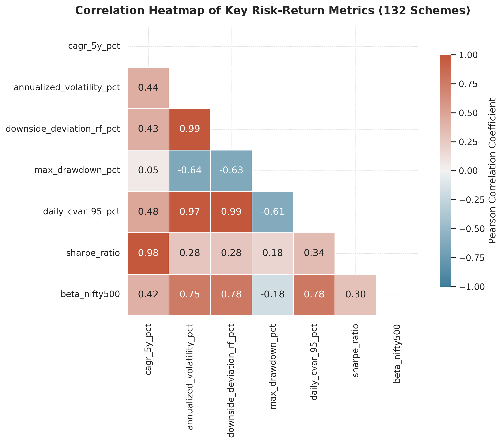
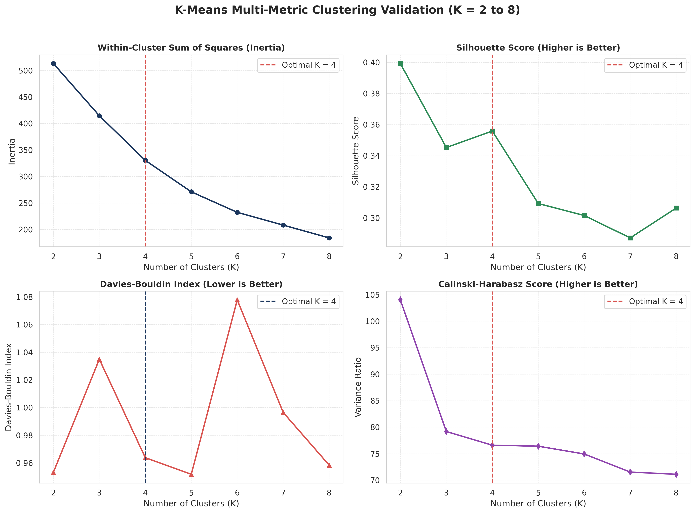
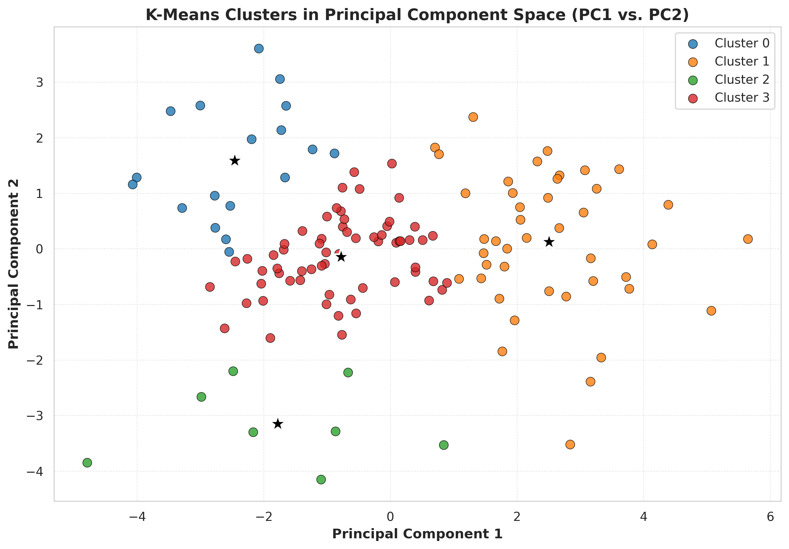
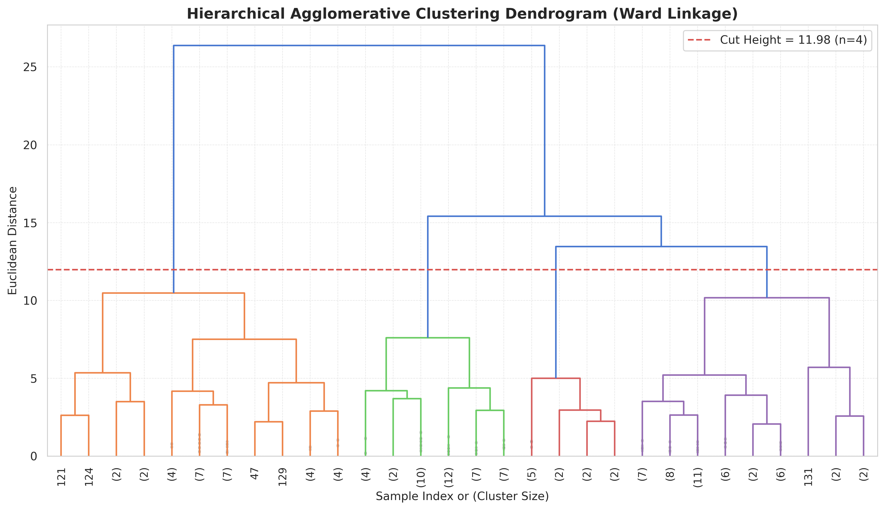
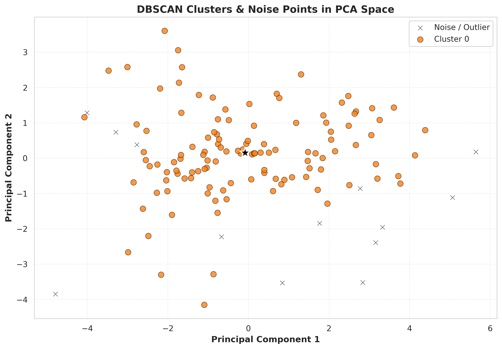
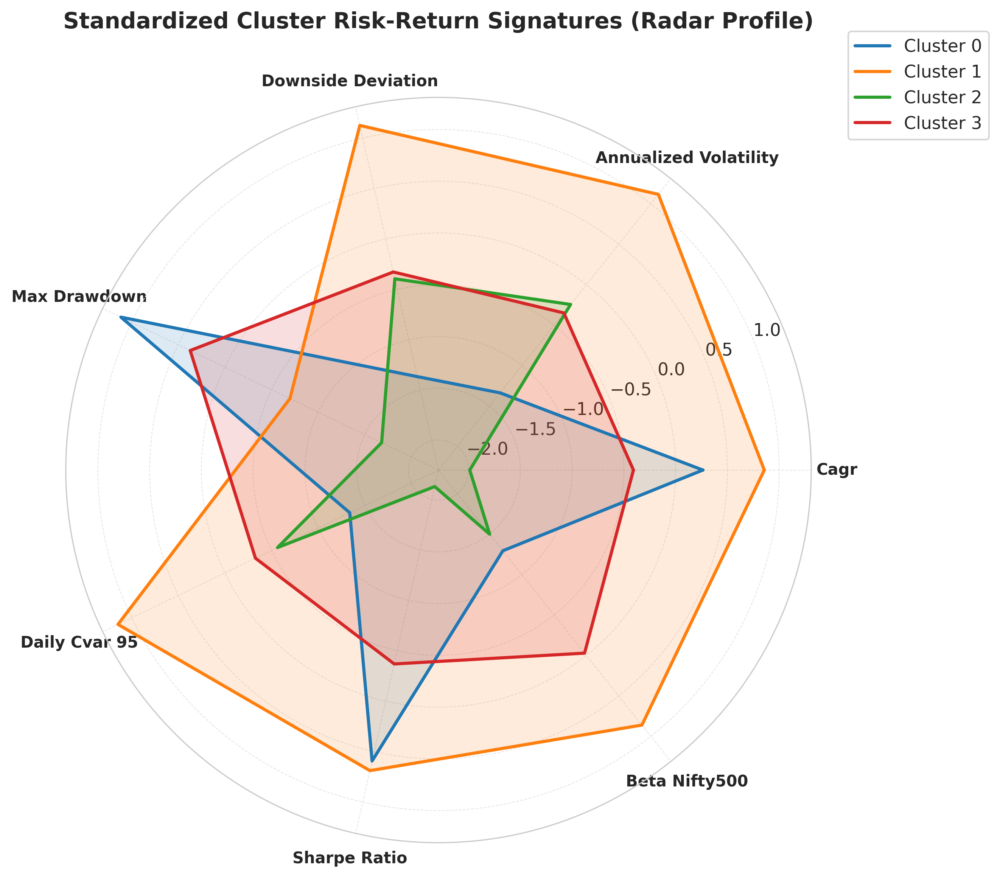

# Machine Learning-Based Risk–Return Profiling and Clustering of Indian Mutual Funds

[](https://www.python.org/downloads/)
[](https://streamlit.io/)
[](LICENSE)

A comprehensive data science and unsupervised machine learning project analyzing **132 open-ended Indian equity mutual fund schemes** (Direct Growth plans across 12 SEBI categories) over a 5-year empirical trading horizon (**October 18, 2021 – October 16, 2026** | 1,232 trading sessions | 162,595 verified observations).

---

## Table of Contents

1. [Research Objectives](#1-research-objectives)
2. [Dataset Description](#2-dataset-description)
3. [Methodology](#3-methodology)
4. [Algorithms & Evaluation Metrics](#4-algorithms--evaluation-metrics)
5. [Key Results](#5-key-results)
6. [Cluster Interpretation](#6-cluster-interpretation)
7. [Project Structure](#7-project-structure)
8. [Installation & Execution](#8-installation--execution)
9. [Interactive Dashboard](#9-interactive-dashboard)
10. [Limitations](#10-limitations)
11. [Conclusion](#11-conclusion)
12. [References](#12-references)

---

## 1. Research Objectives

Traditional classification of Indian mutual funds relies on SEBI regulatory categories (Large Cap, Mid Cap, Small Cap, etc.), which define portfolio composition rules but do not capture actual realized risk–return behavior. This project applies unsupervised machine learning to answer:

1. Do all funds in the same statutory category share similar risk–return profiles?
2. Can data-driven clustering reveal latent investment personas beyond regulatory labels?
3. How do systemic beta and tail risk cluster across equity strategies in practice?

**Specific Goals:**
- Collect and validate 5 years of daily NAV data with a strict **zero-fabrication policy** for missing values.
- Engineer comprehensive risk–return metrics (CAGR, volatility, downside deviation, drawdown, VaR, CVaR, Sharpe, Sortino, Calmar, Beta, Alpha).
- Apply K-Means, Hierarchical Clustering, DBSCAN, and PCA to discover natural fund groupings.
- Statistically justify the optimal cluster count using multiple evaluation criteria.
- Build an interactive Streamlit dashboard for fund exploration and cluster comparison.

---

## 2. Dataset Description

| Attribute | Detail |
|:---|:---|
| **Source** | [AMFI India](https://www.amfiindia.com) official daily NAV feeds & TER disclosures |
| **Universe** | 132 open-ended Direct Growth equity schemes |
| **SEBI Categories** | 12 (Large Cap, Large & Mid Cap, Mid Cap, Small Cap, Flexi Cap, Multi Cap, Focused, ELSS, Value, Contra, Dividend Yield, Sectoral/Thematic) |
| **Time Period** | October 18, 2021 – October 16, 2026 |
| **Trading Sessions** | 1,232 business days (NSE calendar) |
| **Total Observations** | 162,595 verified daily NAV data points |
| **Missing Data** | 29 out of 162,624 potential observations (0.02%) — **not imputed** |
| **Benchmark** | NIFTY 500 Total Return Index (TRI) via Yahoo Finance |
| **Risk-Free Rate** | 6.50% annualized (Indian G-Sec average) |
| **Pre-2021 Inception Guarantee** | All 132 schemes have records starting on or before Oct 18, 2021 |

### Zero-Fabrication Policy
No missing values were forward-filled, backward-filled, interpolated, or synthetically generated. All 29 missing observations remain as explicit `NaN` values, ensuring complete data integrity for academic research.

---

## 3. Methodology

### 3.1 Data Pipeline
1. **Acquisition:** Raw daily NAV data downloaded from AMFI India's official API endpoints; TER disclosures and scheme metadata collected separately.
2. **Cleaning & Validation:** Data type enforcement, duplicate removal, date alignment to NSE trading calendar, outlier flagging via IQR method.
3. **Feature Engineering:** 53 risk–return metrics computed from daily returns, including:
   - **Return Metrics:** 5-Year CAGR, annualized mean return, cumulative return
   - **Risk Metrics:** Annualized volatility, downside deviation, maximum drawdown, daily VaR (95%), daily CVaR (95%)
   - **Risk-Adjusted Metrics:** Sharpe ratio, Sortino ratio, Calmar ratio
   - **Benchmark Metrics:** Market beta, Jensen's alpha, tracking error, information ratio (vs. NIFTY 500 TRI)
4. **Standardization:** Z-score normalization (μ=0, σ=1) applied to all clustering features to prevent scale dominance.

### 3.2 ML Feature Set (7 Core Dimensions)
| # | Feature | Description |
|---|:---|:---|
| 1 | `cagr_5y_pct` | 5-Year Compound Annual Growth Rate (%) |
| 2 | `annualized_volatility_pct` | Annualized standard deviation of daily returns (%) |
| 3 | `downside_deviation_rf_pct` | Semi-deviation below the risk-free rate (%) |
| 4 | `max_drawdown_pct` | Maximum peak-to-trough decline (%) |
| 5 | `daily_cvar_95_pct` | Daily 95% Conditional Value at Risk / Expected Shortfall (%) |
| 6 | `sharpe_ratio` | Excess return per unit of total volatility |
| 7 | `beta_nifty500` | Systematic sensitivity to NIFTY 500 TRI |

---

## 4. Algorithms & Evaluation Metrics

### Algorithms
| Algorithm | Purpose |
|:---|:---|
| **K-Means Clustering** | Centroid-based partitioning; evaluated for K=2 to K=8 |
| **Hierarchical Agglomerative Clustering** | Ward's minimum variance linkage; dendrogram visualization |
| **DBSCAN** | Density-based clustering with explicit outlier detection |
| **Principal Component Analysis (PCA)** | Dimensionality reduction and latent factor decomposition |

### Evaluation Metrics (for optimal K selection)
| Metric | Criterion |
|:---|:---|
| **Within-Cluster Sum of Squares (Inertia)** | Elbow method — diminishing returns |
| **Silhouette Score** | Maximize (higher = better separation) |
| **Davies–Bouldin Index** | Minimize (lower = more compact clusters) |
| **Calinski–Harabasz Score** | Maximize (higher = better-defined clusters) |

### Evaluation Results (K=2 to K=8)
| K | Inertia ↓ | Silhouette ↑ | Davies–Bouldin ↓ | Calinski–Harabasz ↑ |
|:---:|:---:|:---:|:---:|:---:|
| 2 | 513.26 | 0.3993 | 0.9532 | 104.03 |
| 3 | 414.77 | 0.3453 | 1.0350 | 79.19 |
| **4 ✓** | **330.53** | **0.3559** | **0.9638** | **76.61** |
| 5 | 271.20 | 0.3093 | 0.9518 | 76.42 |
| 6 | 232.51 | 0.3016 | 1.0779 | 74.95 |
| 7 | 208.39 | 0.2872 | 0.9965 | 71.54 |
| 8 | 184.25 | 0.3064 | 0.9584 | 71.12 |

**K=4 selected** based on: elbow bend at K=3→4, highest multi-cluster silhouette (0.3559 for K≥3), low Davies–Bouldin (0.9638), and financial interpretability.

---

## 5. Key Results

### PCA Factor Decomposition
- **PC1 (62.83% variance):** "Market Risk & Volatility Factor" — loads on volatility (+0.98), downside deviation (+0.98), CVaR (+0.96), beta (+0.81)
- **PC2 (26.13% variance):** "Risk-Adjusted Quality Factor" — loads on Sharpe ratio (+0.95), CAGR (+0.87)
- **Cumulative 2D variance: 88.96%** — two latent factors capture nearly all fund behavior

### Algorithm Comparison
| Metric | K-Means (K=4) | Hierarchical (Ward) | DBSCAN |
|:---|:---:|:---:|:---:|
| Silhouette Score | **0.356** | 0.264 | 0.312 |
| Davies–Bouldin Index | **0.964** | 1.101 | 1.050 |
| Outlier Detection | No | No | **13 funds flagged** |

### Sample Visualizations

| EDA Correlation Heatmap | K-Means Elbow & Metrics | PCA Cluster Map |
|:---:|:---:|:---:|
|  |  |  |

| Hierarchical Dendrogram | DBSCAN Clusters | Cluster Radar Profile |
|:---:|:---:|:---:|
|  |  |  |

---

## 6. Cluster Interpretation

The optimal K=4 solution segments the Indian mutual fund universe into four distinct investment personas:

| Cluster | Persona | Funds | 5Y CAGR | Volatility | Sharpe | Beta | Max Drawdown |
|:---:|:---|:---:|:---:|:---:|:---:|:---:|:---:|
| **0** | Core Quality Compounders | 18 (13.6%) | 11.57% | 12.47% | 0.41 | 0.81 | -16.29% |
| **1** | Aggressive High-Growth | 43 (32.6%) | 13.45% | 16.40% | 0.43 | 1.01 | -23.32% |
| **2** | Defensive / Stagnant Laggards | 8 (6.1%) | 4.42% | 14.22% | -0.16 | 0.79 | -27.13% |
| **3** | Moderate Balanced Growth | 63 (47.7%) | 9.44% | 14.05% | 0.21 | 0.93 | -19.17% |

**Cluster 0 — Core Quality Compounders:** Lowest volatility (12.47%) and drawdown (-16.29%), strong Sharpe (0.41) and Calmar (0.72) ratios. Dominated by premier Large Cap and disciplined Flexi Cap funds. Best for long-term wealth preservation.

**Cluster 1 — Aggressive High-Growth:** Highest CAGR (13.45%) but elevated risk — high beta (1.01), deep drawdowns (-23.32%). Dominated by Mid Cap and Small Cap funds. Suitable for high-risk-tolerance, long-horizon investors.

**Cluster 2 — Defensive / Stagnant Laggards:** Failed to beat the 6.50% risk-free rate (CAGR 4.42%) while suffering the worst drawdowns (-27.13%). Negative Sharpe ratio. Strong candidates for portfolio elimination.

**Cluster 3 — Moderate Balanced Growth:** The market-tracking mainstream (47.7% of funds). CAGR of 9.44%, beta of 0.93, closely tracking the NIFTY 500 benchmark. Suitable for systematic investment plans (SIPs).

---

## 7. Project Structure

```
Mutual-Fund-ML-Project/
├── README.md                                # Project documentation (this file)
├── requirements.txt                         # Python dependencies
├── .gitignore                               # Git exclusion rules
├── Mutual_Fund_ML_Complete_Dataset.xlsx      # Master 11-sheet Excel workbook (3.2 MB)
├── run_ml_analysis.py                       # ML pipeline orchestrator (main entry point)
├── run_pipeline.py                          # Data acquisition orchestrator
│
├── src/                                     # Source code modules
│   ├── __init__.py
│   ├── fetch_data.py                        # Data acquisition from AMFI APIs
│   ├── clean_validate.py                    # Data cleaning & validation
│   ├── build_ml_dataset.py                  # Metrics computation & Excel builder
│   └── ml_pipeline/                         # Machine learning modules
│       ├── __init__.py
│       ├── data_loader.py                   # Data loading, inspection & standardization
│       ├── eda.py                           # Exploratory data analysis
│       ├── clustering.py                    # K-Means, Hierarchical, DBSCAN, PCA
│       ├── profiling.py                     # Cluster profiling & financial taxonomy
│       └── visualization.py                 # Publication-quality chart generation
│
├── dashboard/                               # Interactive web application
│   └── app.py                               # Streamlit dashboard (6 tabs)
│
├── data/                                    # All data files
│   ├── raw/                                 # Preserved raw data (never modified)
│   │   ├── nav_all_amfi.txt                 # AMFI master NAV text feed
│   │   ├── amfi_ter_disclosures.json        # TER disclosure data
│   │   ├── schemes_manifest.json            # Scheme selection manifest
│   │   └── schemes_raw_json/                # 181 raw scheme JSON responses
│   ├── processed/                           # Cleaned & computed datasets
│   │   ├── equity_nav_5y_wide.csv           # Daily NAV matrix (1,232 × 132)
│   │   ├── daily_returns.csv                # Daily percentage returns
│   │   ├── benchmark_daily_returns.csv      # NIFTY 50 & NIFTY 500 daily returns
│   │   ├── risk_return_metrics.csv          # 53 calculated financial metrics
│   │   ├── ml_features_kmeans.csv           # ML feature matrix
│   │   ├── ml_features_kmeans_standardized.csv  # Z-score standardized features
│   │   ├── scheme_metadata.csv              # Scheme metadata catalog
│   │   └── features_correlation_matrix.csv  # Feature correlation matrix
│   ├── ml_results/                          # ML output files
│   │   ├── clustered_funds_complete.csv     # Fund-level cluster assignments
│   │   ├── kmeans_evaluation_metrics.csv    # K=2..8 evaluation scores
│   │   ├── cluster_profiles_summary.csv     # Cluster summary statistics
│   │   ├── pca_loadings.csv                 # PCA component loadings
│   │   └── pca_explained_variance.csv       # PCA explained variance
│   └── docs/                                # Data documentation
│       ├── data_quality_report.md           # Data quality audit report
│       └── data_sources.md                  # Data source documentation
│
└── reports/                                 # Research outputs
    ├── PROJECT_REPORT.md                    # Complete academic project report
    ├── figures/                             # 14 publication-quality charts (300 DPI)
    │   ├── eda_correlation_heatmap.png
    │   ├── eda_feature_distributions.png
    │   ├── eda_boxplots_by_category.png
    │   ├── eda_risk_return_scatter.png
    │   ├── kmeans_elbow_and_metrics.png
    │   ├── kmeans_pca_clusters_2d.png
    │   ├── hierarchical_dendrogram.png
    │   ├── hierarchical_clusters_pca.png
    │   ├── dbscan_k_distance.png
    │   ├── dbscan_clusters_pca.png
    │   ├── pca_scree_plot.png
    │   ├── pca_biplot.png
    │   ├── cluster_radar_profile.png
    │   └── cluster_category_distribution.png
    └── tables/                              # Statistical summary tables (CSV/JSON)
        ├── descriptive_statistics.csv
        ├── correlation_pearson.csv
        ├── correlation_spearman.csv
        ├── outliers_summary.csv
        ├── kmeans_evaluation_metrics.csv
        ├── cluster_profiles_summary.csv
        ├── cluster_category_crosstab.csv
        ├── cluster_representative_funds.csv
        ├── pca_explained_variance.csv
        ├── pca_loadings.csv
        ├── top_5_sharpe_funds.csv
        ├── bottom_5_sharpe_funds.csv
        ├── category_profiles_summary.csv
        └── data_quality_audit.json
```

---

## 8. Installation & Execution

### Prerequisites
- Python 3.10 or higher
- pip package manager

### Setup
```bash
# Clone the repository
git clone https://github.com/RAJA2004-design/Mutual-Fund-ML-Project-.git
cd Mutual-Fund-ML-Project-

# Install dependencies
pip install -r requirements.txt
```

### Run the ML Analysis Pipeline
```bash
python run_ml_analysis.py
```

This executes the complete pipeline:
1. Data loading, quality inspection, and outlier detection
2. Exploratory Data Analysis with summary statistics and correlation matrices
3. K-Means evaluation (K=2..8), Hierarchical clustering, DBSCAN, and PCA
4. Cluster profiling and financial taxonomy labeling
5. Export of all CSV tables to `data/ml_results/` and `reports/tables/`
6. Generation of 14 high-resolution 300 DPI figures in `reports/figures/`

### Rebuild Datasets from Scratch (Optional)
```bash
# Step 1: Download raw data from AMFI
python run_pipeline.py

# Step 2: Compute all 53 metrics and build the master Excel workbook
python src/build_ml_dataset.py
```

---

## 9. Interactive Dashboard

Launch the Streamlit web application:
```bash
streamlit run dashboard/app.py
```

**Dashboard Features (6 Tabs):**
| Tab | Description |
|:---|:---|
| Executive Dashboard | KPIs, risk-return scatter, cluster distribution pie chart, persona cards |
| Interactive Cluster Map | 2D PCA space, Volatility vs CAGR, Sharpe vs Sortino with category filters |
| Cluster Profiles & Radar | Multi-dimensional radar chart comparing cluster risk-return signatures |
| Fund Explorer | Search any fund, view its metric scorecard, compare against cluster peers |
| Algorithm Evaluation | Interactive Inertia, Silhouette, Davies–Bouldin, and Calinski–Harabasz curves |
| Methodology & Data Dictionary | Mathematical formulations and parameter specifications |

---

## 10. Limitations

1. **Historical Regime Dependence:** The 5-year sample (2021–2026) captures the post-pandemic recovery and subsequent bull market. Extended bear markets could shift cluster boundaries.
2. **Static Clustering:** Standard clustering assumes stationarity over the full period. Fund manager changes, AUM growth, and mandate drift are not modeled.
3. **Risk-Free Rate Sensitivity:** Using 6.50% (Indian G-Sec average) as the risk-free rate; varying between 6.0–7.0% shifts absolute Sharpe levels but preserves relative cluster rankings.
4. **Universe Scope:** Limited to 132 open-ended Direct Growth equity schemes. Debt, hybrid, and international funds are excluded.

---

## 11. Conclusion

This project constructs an end-to-end, reproducible machine learning pipeline for risk–return profiling of Indian equity mutual funds. By combining:
- **Empirical daily NAV data** (162,595 verified observations, zero fabrication)
- **53 financial metrics** spanning return, risk, tail risk, and benchmark sensitivity
- **Four unsupervised algorithms** (K-Means, Hierarchical, DBSCAN, PCA)
- **Multi-metric statistical validation** (Silhouette, Davies–Bouldin, Calinski–Harabasz, Elbow)

we establish that **K=4 clusters** provide an objective, data-driven taxonomy revealing four distinct investment personas — from conservative quality compounders to aggressive growth vehicles and underperforming laggards.

The analysis demonstrates that funds within the same SEBI category can exhibit vastly different risk–return profiles, and that unsupervised learning provides a more robust framework for portfolio construction than regulatory classification alone.

**Reproducibility:** All random seeds are fixed (`random_state=42`), ensuring 100% deterministic results.

---

## 12. References

1. **SEBI** — Circular `SEBI/HO/IMD/DF3/CIR/P/2017/114`: Categorization and Rationalization of Mutual Fund Schemes
2. **AMFI India** — Official daily NAV and TER disclosures: [amfiindia.com](https://www.amfiindia.com)
3. Markowitz, H. (1952). *Portfolio Selection*. The Journal of Finance, 7(1), 77–91
4. Sharpe, W. F. (1966). *Mutual Fund Performance*. The Journal of Business, 39(1), 119–138
5. Sortino, F. A., & van der Meer, R. (1991). *Downside Risk*. The Journal of Portfolio Management, 17(4), 27–31
6. Rousseeuw, P. J. (1987). *Silhouettes: A graphical aid to the interpretation and validation of cluster analysis*. J. Computational and Applied Mathematics, 20, 53–65
7. Ester, M., Kriegel, H. P., Sander, J., & Xu, X. (1996). *A density-based algorithm for discovering clusters in large spatial databases with noise*. KDD-96, 226–231

---

## Author

**RAJA2004-design** — [GitHub Profile](https://github.com/RAJA2004-design)

---

## License

This project is for academic and research purposes.
